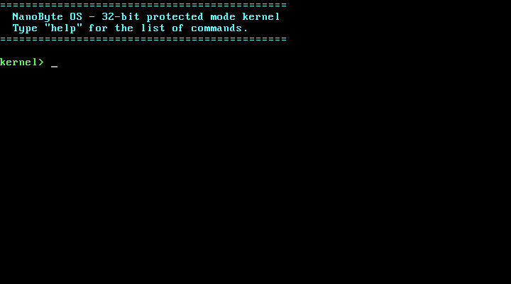
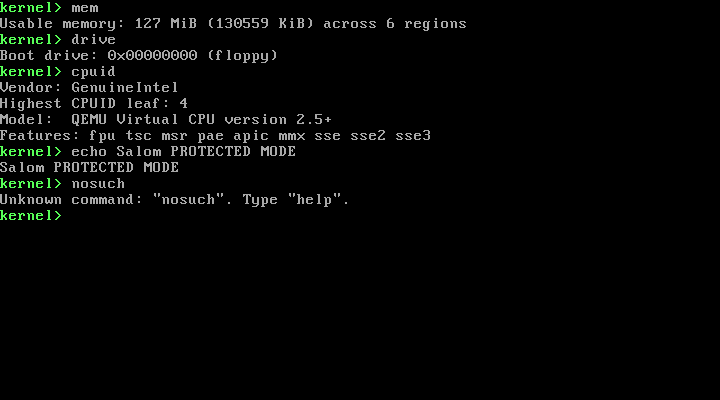
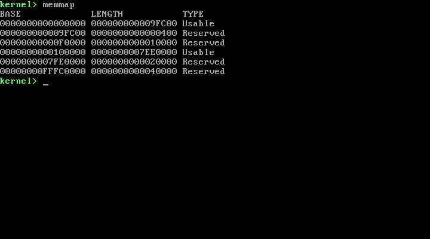
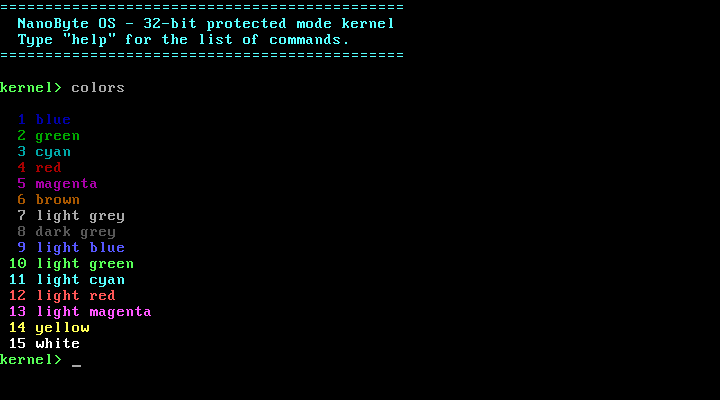

# NanoByte OS

A small x86 operating system: a 512 byte FAT12 boot sector, a second stage
bootloader that prepares the machine and switches to protected mode, and a
32-bit kernel written in C with its own VGA and keyboard drivers.

```text
Boot Stage2 loaded
  A20 enabled
  memory map: 6 regions
  loading KERNEL.BIN ... ok
  entering protected mode

=============================================
  NanoByte OS - 32-bit protected mode kernel
  Type "help" for the list of commands.
=============================================

kernel> cpuid
Vendor: GenuineIntel
Highest CPUID leaf: 4
Model:  QEMU Virtual CPU version 2.5+
Features: fpu tsc msr pae apic mmx sse sse2 sse3

kernel> mem
Usable memory: 127 MiB (130559 KiB) across 6 regions
```

Commands: `help`, `clear`, `about`, `echo <text>`, `mem`, `memmap`, `cpuid`,
`drive`, `colors`, `reboot`, `halt`.

## Screenshots

Taken from QEMU booting `build/main_floppy.img`.

| The kernel right after boot | The shell |
| --- | --- |
|  |  |

| The BIOS memory map | Text mode colors |
| --- | --- |
|  |  |

## Layout

| Path | What it is |
| --- | --- |
| `src/bootloader/stage1/boot.asm` | the boot sector: just enough FAT12 to load stage 2 |
| `src/bootloader/stage2/main.asm` | A20, memory map, FAT12 driver, GDT, protected mode |
| `src/kernel/entry.asm` | 32-bit entry stub: stack, zeroed `.bss`, calls `kmain` |
| `src/kernel/main.c` | the shell and its commands |
| `src/kernel/vga.c` | text mode driver, writes to `0xB8000` |
| `src/kernel/keyboard.c` | polled PS/2 keyboard driver |
| `src/kernel/string.c` | the few libc functions a freestanding build needs |
| `src/kernel/linker.ld` | links the kernel at 1 MiB |
| `run.sh` / `debug.sh` | boot in QEMU, optionally waiting for gdb |

## Requirements

* `nasm` — assembler
* `i686-elf-gcc`, `i686-elf-binutils` — a cross compiler that targets bare
  i686, so nothing from the host libc or dynamic loader ends up in the image
* `mtools` — `mformat` / `mcopy`, used to build the FAT12 filesystem (works on
  both macOS and Linux, unlike `mkfs.fat`)
* `qemu-system-i386` — to actually boot the result

```bash
# macOS
brew install nasm mtools qemu i686-elf-gcc i686-elf-binutils

# Arch Linux
yay -S nasm mtools qemu-system-x86 i686-elf-gcc i686-elf-binutils
```

## Building and running

```bash
make          # assemble, compile, link and build build/main_floppy.img
make run      # build, then boot the image in QEMU
make debug    # boot with the CPU halted, gdb stub on localhost:1234
make dump     # hexdump of the boot sector
make clean
```

## Memory layout

```text
0x00000 - 0x004FF   real mode IVT and BIOS data area
0x00500 - 0x07BFF   stage 2
0x07C00 - 0x07DFF   the boot sector, kept resident for its BPB
0x07E00 - 0x09FFF   stage 1 scratch buffer (root directory, FAT)
0x08000 - 0x08FFF   boot info: memory map, entry count, boot drive
0x0A000 - 0x0BFFF   stage 2 scratch buffer (root directory, FAT)
0x20000 - ......    the kernel image, as read by the BIOS
0x90000             protected mode stack used during the handover
0x100000 - .....    where the kernel actually runs
```

## Stage 1 — the boot sector

The BIOS only ever loads 512 bytes, so the boot sector does the smallest job
that still gets us going.

1. The BIOS loads it at `0x0000:7C00` and passes the boot drive in `DL`. It
   normalizes `CS:IP` with a far return (some BIOSes enter at `07C0:0000`),
   sets up a stack below itself and stores the drive number.
2. `int 13h, ah=08h` asks the BIOS for the real drive geometry, which
   overrides the sectors-per-track and head count in the BPB. Trusting the
   values on the disk breaks as soon as the image is booted from something
   that is not a 1.44MB floppy.
3. It computes the root directory LBA from the BPB
   (`reserved_sectors + fat_count * sectors_per_fat`), reads the directory and
   scans it for the 8.3 name `STAGE2  BIN`.
4. It reads the FAT and walks the file's cluster chain. FAT12 packs two 12-bit
   entries into three bytes, so the entry for a cluster lives at byte offset
   `cluster * 3 / 2` and is either the low or the high 12 bits of the word
   found there. The chain ends at `0xFF8` or above.
5. Stage 2 is loaded at `0x0000:0x0500` and entered with `DL` still set.

The boot sector stays resident afterwards, which is why stage 2 can read the
BPB — including the patched geometry — straight out of `0x7C00`.

## Stage 2 — everything the BIOS is still needed for

* **A20**: tries the BIOS (`int 15h, ax=2401`), then the keyboard controller,
  then the fast A20 port `0x92`, verifying after each attempt by writing two
  different bytes to a pair of addresses exactly 1 MiB apart and checking
  whether the second aliases onto the first. Without A20 the kernel could not
  live at 1 MiB at all.
* **Memory map**: walks `int 15h / E820` into `0x8000` — 24 bytes per region
  (base, length, type, ACPI attributes) with the count and the boot drive in
  the two words before it. This *must* happen now; `int 15h` disappears the
  moment we leave real mode.
* **Kernel**: `fat_load_file` reads `KERNEL.BIN` into low memory, where BIOS
  disk calls can reach, and takes the exact byte count from the directory
  entry.
* **Protected mode**: loads a flat GDT (null, ring 0 code, ring 0 data, both
  covering the full 4 GiB), sets `CR0.PE`, far jumps to reload `CS` with a
  32-bit selector, reloads the data segments, copies the kernel up to 1 MiB
  with `rep movsd` and jumps to it.

Failures are not silent. Stage 1 prints `DiskErr` or `NoStage2`, stage 2 prints
a full sentence, and both wait for a keypress and reboot through `jmp 0FFFFh:0`.

## The kernel

`entry.asm` is the first thing in the image, because stage 2 jumps at the load
address without looking at any header. It sets up a 16 KiB stack, zeroes
`.bss` — C assumes uninitialized globals start at zero, and a raw binary
carries no zeroed pages — and calls `kmain`.

From there everything is C, and everything talks to hardware directly, because
protected mode left the BIOS behind:

* **`vga.c`** writes character/attribute pairs into the framebuffer at
  `0xB8000` and drives the hardware cursor through the CRT controller's
  index/data port pair at `0x3D4`/`0x3D5`. It handles newlines, backspace,
  tabs and scrolling.
* **`keyboard.c`** polls the PS/2 controller's status port for a full output
  buffer and decodes scancode set 1, tracking shift and caps lock. There is no
  IDT yet, so IRQ1 cannot be serviced — that is the next step.
* **`main.c`** reads a line and dispatches it. `cpuid` runs the instruction
  directly, `mem` sums the usable E820 regions, and `reboot` pulses the CPU
  reset line through the keyboard controller, since there is no BIOS left to
  ask.

Still missing, roughly in the order they should arrive: an IDT with exception
handlers, a remapped PIC and real interrupt-driven drivers, a physical page
allocator and paging, then a disk driver and a filesystem the kernel can read
on its own.
